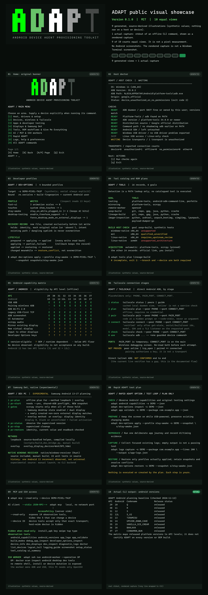

<p align="center">
  
</p>

<h3 align="center">Android Device Agent Provisioning Toolkit</h3>

<p align="center">
  Set up adb, inspect Android devices and prepare test sessions, from the terminal or from an AI agent.
</p>

<p align="center">
  <b>Alpha</b> &middot; MIT &middot; Python 3.11+ &middot; Windows and Linux
</p>

---

ADAPT wraps Google's official Platform-Tools (`adb`) in a command-line toolkit and a local [MCP](https://modelcontextprotocol.io) server. It installs `adb` for your user, checks your host, connects over USB, Wi-Fi, Tailscale or SSH, inspects devices, and adds developer tooling: Developer Options test profiles, bounded log capture, app checks and Samsung DeX display tools.



## Why ADAPT

- **Safe on a shared machine.** ADAPT never runs `adb kill-server` or `sudo adb`. Before using the ADB server it checks that the server is yours and matches its adb version.
- **You choose the device.** Device workflows take the serial you name, and tools that act on a phone never pick one for you.
- **Changes you can undo.** Developer Options profiles save the original settings first and can restore them.
- **Failures are explained.** When something fails, ADAPT says why and what to try next. `adapt explain` looks up any failure offline.
- **Built for agents.** A local MCP server with read-only and per-device restrictions. Most commands also offer `--json`.
- **Plain reporting.** Reports say what was observed and what was not. Root, ROM and bootloader results are indicators, not proof.

## Install

Install **Python 3.11 or newer** and [pipx](https://pipx.pypa.io/stable/how-to/install-pipx.html), then:

```text
pipx install "https://github.com/primary-null/ADAPT/releases/download/v0.1.1/adapt_adb-0.1.1-py3-none-any.whl"
pipx ensurepath
adapt --help
```

For the MCP server, install with the `mcp` extra instead:

```text
pipx install "adapt-adb[mcp] @ https://github.com/primary-null/ADAPT/releases/download/v0.1.1/adapt_adb-0.1.1-py3-none-any.whl"
```

ADAPT is not on PyPI; use the release URL. Checksums, attestations and update steps are in the [release notes](https://github.com/primary-null/ADAPT/releases/tag/v0.1.1) and [Release process](docs/releasing.md).

This README describes the repository's current code. The 0.1.1 download is older: it does not have failure explanations, `adapt explain`, the `dex receiver-*` commands or DeX detection on newer Samsung firmware. To get those, install from a checkout:

```text
git clone https://github.com/primary-null/ADAPT.git
cd ADAPT
python -m venv .venv
# PowerShell: .\.venv\Scripts\Activate.ps1      bash/zsh: source .venv/bin/activate
python -m pip install -e ".[mcp]"
```

## Quick start

```text
adapt doctor                  # check the host, adb, the ADB server, drivers and devices
adapt setup --dry-run         # preview the Platform-Tools install
adapt setup                   # install it (asks first)
adapt devices                 # list connected devices
```

Wireless debugging (Android 11+) uses two different ports, one to pair and one to connect:

```text
adapt pair 192.0.2.10:PAIR_PORT          # prompts for the pairing code
adapt connect 192.0.2.10:CONNECT_PORT
```

Inspect a device by the serial shown in `adapt devices`:

```text
adapt android capabilities -s SERIAL
adapt dev-options inspect -s SERIAL
adapt app validate -s SERIAL --package com.example.app
adapt logs capture -s SERIAL --package com.example.app --lines 200 --output app-logs.json
```

No device handy? Try `adapt help-me --all`, `adapt tools list` or `adapt explain --list`. Run bare `adapt` for the interactive console.

## What it does

| Area | Commands |
|---|---|
| Host setup and checks | `setup`, `doctor`, `everything` |
| ADB and wireless | `devices`, `adb`, `pair`, `connect` |
| Remote access | `tailscale`, `ssh` |
| Device inspection | `android`, `detect` |
| Developer testing | `dev-options`, `app`, `debug`, `logs`, `rapid` |
| Displays and Samsung DeX | `desktop`, `dex` |
| Tools | `tools`, `guide` |
| AI and help | `agent`, `mcp`, `help-me`, `explain`, `tips`, `console` |

73 commands in all. [Features](docs/features.md) describes each area; the [Command reference](docs/command-reference.md) lists every flag.

## For AI agents

Tell your agent to run `adapt agent primer`. It prints what ADAPT is, the first steps, the development loop, safety rules written for an agent, and every command and MCP tool (`--json` gives the same as structured data). It is built from the installed commands, so it matches your version.

To give an agent MCP tools instead, or as well, let ADAPT register the local server with the agent's client, or add it yourself:

```text
adapt agent clients                          # which AI clients are installed here
adapt agent install claude-code --dry-run    # show the exact change; add --yes to apply it
adapt agent skill install --scope project    # optional: the Agent Skill, for agents that read .agents/skills
```

ADAPT changes a client's settings only when you run `adapt agent install`, shows the change first, and keeps a backup. Or paste the MCP entry yourself:

```json
{
  "mcpServers": {
    "adapt": { "command": "adapt", "args": ["mcp", "--read-only", "--device", "SERIAL"] }
  }
}
```

`adapt mcp` is a local stdio server with 38 tools and no network listener. `--read-only` keeps the 24 observation tools, and `--device` limits calls to the devices you list. The 14 tools that act on a phone (`tap`, `swipe`, `key`, `type`, `install_apk`, `app_launch`, `app_stop`, `app_open_link`, `test_run`, `dev_options_apply`, `dev_options_restore`, `permission_grant`, `permission_revoke`, `ui_tap_text`) never choose a device themselves. Thirteen of the 38 (launch, stop and state of an app, log marks, test runs, reversible Developer Options profiles, permissions, tapping by text, waiting for the screen) support a build, install, launch, observe, act and restore loop; they are offline-tested only and have not been run against a device. Read-only mode still lets a model see screens and logs, so treat it as sensitive. The server sends short orientation instructions, a title and standard annotations for each tool, and its guidance as `adapt://` resources and a `help` tool. These and `adapt agent install` are offline-tested only; no AI client has yet been observed reading them and no client registration has been live-checked.


More in [MCP access](docs/mcp-access.md) and the [client examples](examples/README.md).

## How it fits together

```text
 terminal ----> adapt CLI ---+                         +--> USB ----------> Android
                              +--> argument checks --> adb --> Wi-Fi ------> device(s)
 AI client --stdio--> adapt mcp --+   safety guard       +--> routed (Tailscale / VPN)
                       (--read-only, --device)   ADB server check
 SSH worker:  adapt ssh run HOST --operation OP   -->  remote adapt (read-only) --> its own adb
```

More topologies in [Architecture](docs/architecture.md).

## Status

ADAPT is **alpha**: commands and output can change between releases, and no device or host is certified.

- **Tested on** Windows 11 with Samsung devices on Android 13, 16 and 17.
- **Linux** has automated tests only so far. macOS is not supported.
- **`adapt adb` is a guarded passthrough, not a sandbox.** It blocks a short list of destructive commands and runs everything else as typed.

Test records are in [Validation](docs/validation.md), and every known limit is in [Known limitations](docs/known-limitations.md).

## Native Windows receiver (experimental)

`native/windows-receiver` is Rust source for a PC-side wireless DeX receiver, derived from the MIT-licensed [DeXDesk](https://github.com/adirh3/DeXDesk). You build it yourself; it is not part of the Python package. It has been run with three Samsung devices on Windows 11.

By default it accepts any phone in Wi-Fi Direct range; you can restrict it to one device. `adapt dex receiver-plan` explains how to build and start it, and its [README](native/windows-receiver/README.md) has the details.

## Documentation

| Start here | Reference | Guides |
|---|---|---|
| [Features](docs/features.md) | [Command reference](docs/command-reference.md) | [Doctor and setup](docs/doctor.md) |
| [Architecture](docs/architecture.md) | [MCP access](docs/mcp-access.md) | [Tailscale](docs/tailscale.md), [SSH workers](docs/ssh-workers.md), [Hypervisors](docs/hypervisors.md) |
| [Known limitations](docs/known-limitations.md) | [Android support](docs/android-support.md) | [Developer options](docs/dev-options.md), [App and debug validation](docs/development-validation.md), [Rapid ADAPT](docs/rapid-adapt.md) |
| [Validation](docs/validation.md) | [Tools catalog](docs/tools.md), [scrcpy](docs/scrcpy.md) | [Samsung DeX](docs/dex.md), [DeX for PC](docs/dex-pc.md), [Desktop testing](docs/desktop-testing.md) |
| [Offline showcase](docs/showcase/index.html) | [Device detection](docs/device-detection.md) | [Console](docs/console.md), [Help and tips](docs/help.md), [Give Me Everything](docs/everything.md), [AI clients](docs/clients.md) |

Platform notes: [Windows](packaging/windows/README.md), [Linux](packaging/linux/README.md). A printable overview of the earlier 0.1.0 release: [PDF](docs/ADAPT-overview.pdf).

## Contributing and license

Contributions are welcome; read [CONTRIBUTING.md](CONTRIBUTING.md) first. ADAPT is released under the [MIT License](LICENSE), with third-party notices in [THIRD-PARTY-NOTICES.md](THIRD-PARTY-NOTICES.md). It is not affiliated with Google, Samsung, Microsoft or Tailscale.
