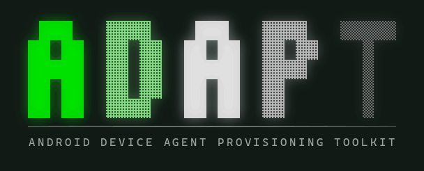

<p align="center">
  
</p>

<h3 align="center">Android Device Agent Provisioning Toolkit</h3>

<p align="center">
  Provision, inspect and test Android devices from the terminal or from an AI agent,<br>
  with exact targets, bounded actions and recoverable changes.
</p>

<p align="center">
  <b>Alpha</b> &middot; MIT &middot; Python 3.11+ &middot; Windows 11 and Debian/Linux &middot; Android 10-17 (API 29-37)
</p>

---

ADAPT wraps Google's official Platform-Tools (`adb`) in a command-line toolkit and a local stdio [MCP](https://modelcontextprotocol.io) server. It sets up `adb` in user scope, checks your host and the shared ADB daemon, drives USB, wireless and routed transports, inspects capabilities, and gives developers recoverable test profiles, bounded logs, app validation and Samsung DeX display tooling. Every device command takes an exact target, every mutation made by ADAPT's own workflows is explicit and reversible where Android allows, and every report says what it did **not** prove. The raw `adapt adb` passthrough is guarded but runs what you type, with no recovery snapshot.


<sub>The [offline showcase](docs/showcase/index.html) (open the HTML file in a browser after cloning) uses generated, source-derived illustrations and one capture of real offline CLI output. It contains no Android screenshots and is not test evidence.</sub>

## Why ADAPT

- **Safe on a shared machine.** Never `adb kill-server`, never `sudo adb`; the port-5037 server is verified before use; destructive package commands are refused.
- **Exact targets.** Device workflows require a serial, and MCP sessions can be pinned to specific transports. The guarded `adb` runner can select and pin the sole ready transport; it refuses ambiguity.
- **Recoverable.** Developer Options profiles write an identity-bound snapshot first, read every value back, and restore only what still holds ADAPT's value.
- **Agent-ready.** 24 MCP tools (19 observation, 5 mutating), a `--read-only` mode, `--device` restriction and strict, bounded schemas. Clean `--json` for scripts.
- **Honest.** Reports carry `claim_boundary` notes. Heuristics (root, ROM, bootloader), version eligibility and planning output are never presented as proof.
- **Wide, not shallow.** Wired and wireless ADB, Tailscale and SSH workers, scrcpy, generic virtual displays, Samsung DeX, logs, app/debug validation.

## At a glance

| | |
|---|---|
| Functional areas | **19** |
| CLI | **64** visible leaf commands in **13** groups (root + 12), plus 2 hidden aliases |
| MCP | **24** tools: 19 observation + 5 mutating; 18 read-only tools with an exact-device restriction |
| Tool catalog | **16** tools, **6** goals; 2 with verified automatic acquisition, 14 manual guidance |
| Developer Options | **4** profiles, **13** inspected settings |
| Built-in help | **59** authored topics, a home console with 9 areas |
| Android matrix | 9 baselines, API 29-37 (Android 10-17 including 12L) |
| Physical evidence | **2** Samsung phones (API 33 and API 37). Everything else is offline-tested or planning |

## Download and install

**[Download ADAPT 0.1.0 (alpha)](https://github.com/primary-null/ADAPT/releases/tag/v0.1.0)**

ADAPT is a terminal application for Windows and Linux. Install **Python 3.11 or newer** and
[pipx](https://pipx.pypa.io/stable/how-to/install-pipx.html), then run:

```text
pipx install "https://github.com/primary-null/ADAPT/releases/download/v0.1.0/adapt_adb-0.1.0-py3-none-any.whl"
pipx ensurepath
adapt --help
```

Open a new terminal after `pipx ensurepath` if `adapt` is not found. No Git checkout or administrator
permission is required. There is no assumed PyPI publication; use the GitHub URL above rather than
`pipx install adapt-adb`. The same wheel supports Windows and Linux. It includes the Android DeX bridge
resource; the experimental native Windows receiver remains a separate manual-build project.

For the optional MCP server, use this instead of the first install command:

```text
pipx install "adapt-adb[mcp] @ https://github.com/primary-null/ADAPT/releases/download/v0.1.0/adapt_adb-0.1.0-py3-none-any.whl"
```

You can also download the `.whl` from the release and install the local file with
`pipx install ./adapt_adb-0.1.0-py3-none-any.whl`. Verify it against the release's `SHA256SUMS.txt`
(`Get-FileHash` on Windows or `sha256sum` on Linux). GitHub build provenance attestations are provided.
The `.tar.gz` is a source distribution for developers, not a desktop installer.

**Updates:** use the new release's wheel URL with `pipx install --force URL`, retaining `[mcp]` if used.
These URLs pin an exact version; `pipx upgrade` does not discover a different GitHub release automatically.
Uninstall with `pipx uninstall adapt-adb`. The package does not certify devices or bundle an Android SDK.
See [Release process](docs/releasing.md) for checks, compatibility and verification.

### Install from a checkout (contributors)

ADAPT needs **Python 3.11 or newer**. Editable installation is for developing ADAPT itself.

```text
git clone https://github.com/primary-null/ADAPT.git
cd ADAPT
python -m venv .venv
# PowerShell: .\.venv\Scripts\Activate.ps1      bash/zsh: source .venv/bin/activate
python -m pip install -e .            # CLI only
python -m pip install -e ".[mcp]"     # CLI + MCP server (adds the MCP SDK and Pillow)
adapt --help                          # or: python -m adapt_adb --help
```

## Quick start

```text
adapt doctor                  # host, adb, port 5037 safety, drivers/udev, devices
adapt setup --dry-run         # preview the user-scope Platform-Tools install
adapt setup                   # install it (asks first in a terminal)
adapt devices                 # list transports
```

Wireless debugging (Android 11+): pair and connect use **two different ports**.

```text
adapt pair 192.0.2.10:PAIR_PORT          # prompts for the pairing code
adapt connect 192.0.2.10:CONNECT_PORT
```

Inspect a device you name explicitly (`SERIAL` is the identifier from `adapt devices`):

```text
adapt android capabilities -s SERIAL --json
adapt dev-options inspect -s SERIAL
adapt app validate -s SERIAL --package com.example.app --expect-debuggable false
adapt logs capture -s SERIAL --package com.example.app --lines 200 --output app-logs.json
```

Try ADAPT without a device: `adapt android versions`, `adapt help-me --all`, `adapt tools list`, `adapt rapid plan -s SERIAL --package com.example.app`.

Run bare `adapt` in a terminal for the home console (nine areas, `H` Home, `B` Back).

## What it does

| Area | Commands | Highlights |
|---|---|---|
| Host provisioning and doctor | `setup`, `doctor`, `everything` | Verified Google download, safe extraction, 5037 preflight, driver/udev guidance |
| ADB and wireless | `devices`, `adb`, `pair`, `connect` | Guarded runner, exact targets, separate pair/connect |
| Tailscale and SSH workers | `tailscale` (13), `ssh` (4) | One verified peer, no secrets in argv, strict OpenSSH worker checks |
| Capabilities and detection | `android`, `detect` | Android 10-17 matrix, root/ROM/bootloader *indicators* |
| Developer testing | `dev-options`, `app`, `debug`, `logs`, `rapid` | 4 recoverable profiles, bounded UID logs, app validation, plan-only Rapid loop |
| Displays and DeX | `desktop`, `dex` (12) | scrcpy virtual displays, dual DeX mirror, experimental activation |
| Tools | `tools`, `guide` | 16-tool catalog, verified scrcpy installer |
| AI and help | `mcp`, `help-me`, `tips`, `console` | 24 tools, 59 help topics |

Details for every area: [Features](docs/features.md). Every flag of every command: [Command reference](docs/command-reference.md).

## For AI agents

```json
{
  "mcpServers": {
    "adapt": { "command": "adapt", "args": ["mcp", "--read-only", "--device", "SERIAL"] }
  }
}
```

`adapt mcp` is a local stdio server (no network listener). `--read-only` keeps the 19 observation tools; `--device` restricts exact transports and drops host-wide `doctor`; together they expose 18 tools. Read-only still lets a model see screens and logs, so treat it as sensitive. No external AI client has been live-accepted. See [MCP access](docs/mcp-access.md).

## How it fits together

```text
 terminal ----> adapt CLI ---+                         +--> USB ----------> Android
                              +--> argument checks --> adb --> Wi-Fi ------> device(s)
 AI client --stdio--> adapt mcp --+   safety guard       +--> routed (Tailscale / VPN)
                       (--read-only, --device)   5037 preflight
 SSH worker:  adapt ssh run HOST --operation OP   -->  remote adapt (read-only) --> its own adb
```

More topologies, including routed ADB over Tailscale, SSH workers and the DeX display paths: [Architecture](docs/architecture.md).

## Status and honest limits

ADAPT is **alpha**. Automated tests are offline and mocked; physical observations come from **two Samsung phones** only. Highlights you should know:

- A **direct Tailscale end-to-end run is unproven** (the strict TLS-port check met an empty property on the tested firmware); a private routed VPN path did work.
- **Root and ROM indicators are not proof**; Samsung Download mode is not fastboot; ADAPT never unlocks, flashes, roots or builds ROMs.
- **Rapid ADAPT is a planner**, not an auto-runner; debug commands never attach a debugger.
- DeX activation is **experimental** and may be denied by firmware; a virtual display is not DeX.
- The catalog's ROM and image tools are manual gathering guidance, not installed by ADAPT.

Full list: [Known limitations](docs/known-limitations.md). Recorded checks: [Validation](docs/validation.md).

## Native Windows receiver (experimental source)

`native/windows-receiver` contains Rust source for a PC-side wireless-DeX receiver, derived from the MIT-licensed [DeXDesk](https://github.com/adirh3/DeXDesk) (commit `5070ccda5c363f5ed0b46d1fe7cf2c15c47fc125`). It is **manual-build and experimental, outside the Python package**, not launched by ADAPT, admits a phone by friendly name (not cryptographic), and uses an undocumented Windows advertisement provider. Its 15 offline tests passed again from this public source; see [validation](docs/validation.md) and its [README](native/windows-receiver/README.md).

## Documentation

| Start here | Reference | Guides |
|---|---|---|
| [Features](docs/features.md) | [Command reference](docs/command-reference.md) | [Doctor and setup](docs/doctor.md) |
| [Architecture](docs/architecture.md) | [MCP access](docs/mcp-access.md) | [Tailscale](docs/tailscale.md), [SSH workers](docs/ssh-workers.md), [Hypervisors](docs/hypervisors.md) |
| [Known limitations](docs/known-limitations.md) | [Android support](docs/android-support.md) | [Developer options](docs/dev-options.md), [App and debug validation](docs/development-validation.md), [Rapid ADAPT](docs/rapid-adapt.md) |
| [Validation](docs/validation.md) | [Tools catalog](docs/tools.md), [scrcpy](docs/scrcpy.md) | [Samsung DeX](docs/dex.md), [DeX for PC](docs/dex-pc.md), [Desktop testing](docs/desktop-testing.md) |
| [Offline showcase](docs/showcase/index.html) | [Device detection](docs/device-detection.md) | [Console](docs/console.md), [Help and tips](docs/help.md), [Give Me Everything](docs/everything.md), [AI clients](docs/clients.md) |

Platform notes: [Windows](packaging/windows/README.md), [Linux](packaging/linux/README.md). MCP client examples: [`examples/`](examples/README.md).

Printable overview: [ADAPT overview PDF](docs/ADAPT-overview.pdf). Static title fallback: [PNG](docs/assets/adapt-title.png).

## Contributing, license and notices

Contributions are welcome; read [CONTRIBUTING.md](CONTRIBUTING.md) first (safety rules, privacy rules, offline tests). ADAPT is released under the [MIT License](LICENSE). Third-party and upstream notices, including the DeXDesk-derived receiver, are in [THIRD-PARTY-NOTICES.md](THIRD-PARTY-NOTICES.md). ADAPT is not affiliated with Google, Samsung, Microsoft or Tailscale.
